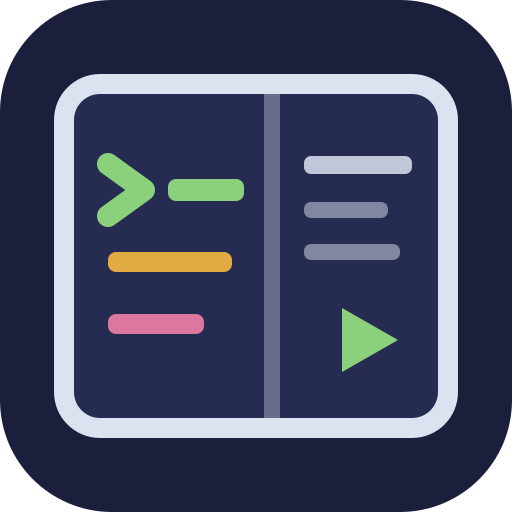
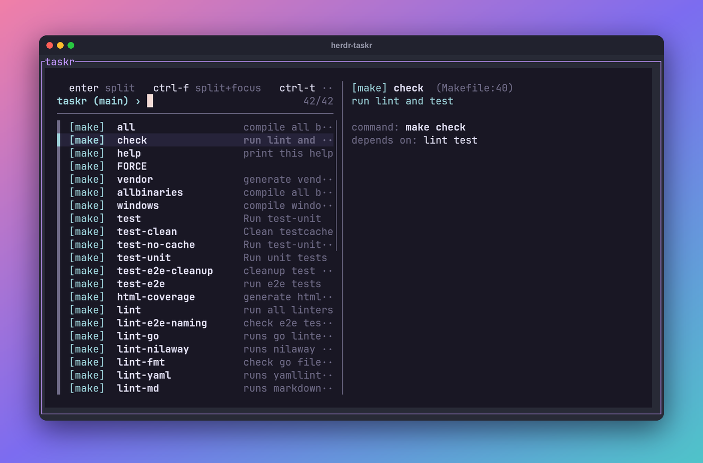

# herdr-taskr

Run your project's tasks from inside [herdr](https://herdr.dev) without typing them.

Press a key, type a few letters to find the task you want, and press Enter. The list goes away and the task runs next to you while you keep working.

It finds tasks in Justfiles, Makefiles, Taskfiles, `package.json` scripts and Cargo projects.



## Install

```sh
herdr plugin install chmouel/herdr-taskr
```

You also need `fzf` and Python 3.11 or newer.

Then add a key to `~/.config/herdr/config.toml`:

```toml
[[keys.command]]
key = "prefix+t"
type = "plugin_action"
command = "herdr-taskr.launch"
description = "Run project task"
```

## Keys

| Key | Where the task runs |
| --- | --- |
| `Enter` | in a split next to you |
| `Ctrl-F` | in a split, and moves you there |
| `Ctrl-T` | in a new tab |
| `Ctrl-B` | out of sight, with a notification when it's done |
| `Ctrl-A` | out of sight, then hands the output to your coding agent |

## Extras

herdr-taskr can re-run your last task without opening the list. Bind the `herdr-taskr.rerun` action to a key the same way as above.

The `herdr-taskr.send-to-agent` action takes the output of your last task and pastes it into the coding agent running in the same workspace, so you can ask it to fix a failing test or build.

## Settings

All settings are optional. Put them in `~/.config/herdr/plugins/config/herdr-taskr/config.toml`:

```toml
# Put the last task you ran at the top of the list
remember_last = true

# What Enter does: "split-bg", "split-focus", "tab", "background" or "agent"
default_mode = "split-bg"

# Which kinds of tasks to look for, in this order
providers = ["just", "make", "task", "npm", "cargo"]
```

## License

MIT
